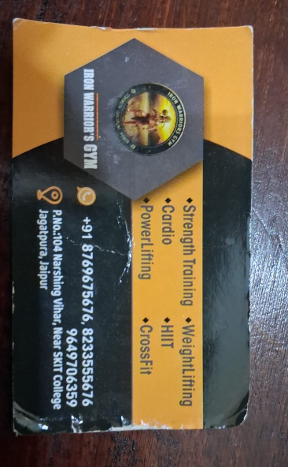
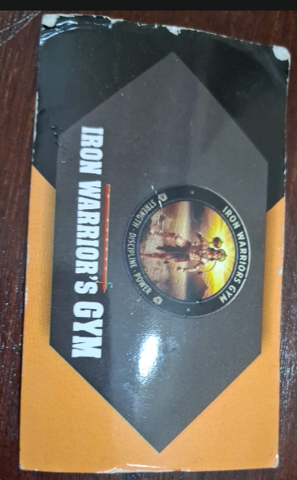

i want you to make a website for gym which looks like this
https://www.formulafitnessindia.com/

but they have there photos on the map so take it from maps
https://www.google.co.in/maps/place/IRON+WARRIOR%E2%80%99S+GYM/@26.8238437,75.8660417,359m/data=!3m1!1e3!4m14!1m7!3m6!1s0x396db770070b115f:0x6f306afd08a3e737!2sSwami+Keshvanand+Institute+of+Technology,+Management+%26+Gramothan+(SKIT)!8m2!3d26.8231367!4d75.8666069!16s%2Fg%2F1tl8j39g!3m5!1s0x396dc9627299a5d1:0xb68373eb67004602!8m2!3d26.8241008!4d75.8650497!16s%2Fg%2F11mscbp15l?entry=ttu&g_ep=EgoyMDI2MTExMC4wIKXMDSoASAFQAw%3D%3D

also take reviews from here which is showed in the website

and upload it on github then on the vercel
and give me the vercel link
and like should be simple like iron worrior.vercel.com

also take logo and numbers from this make a simple website like the one i have given u and deploy it on vercel

and do it very fast i have less time do not spend more token on it